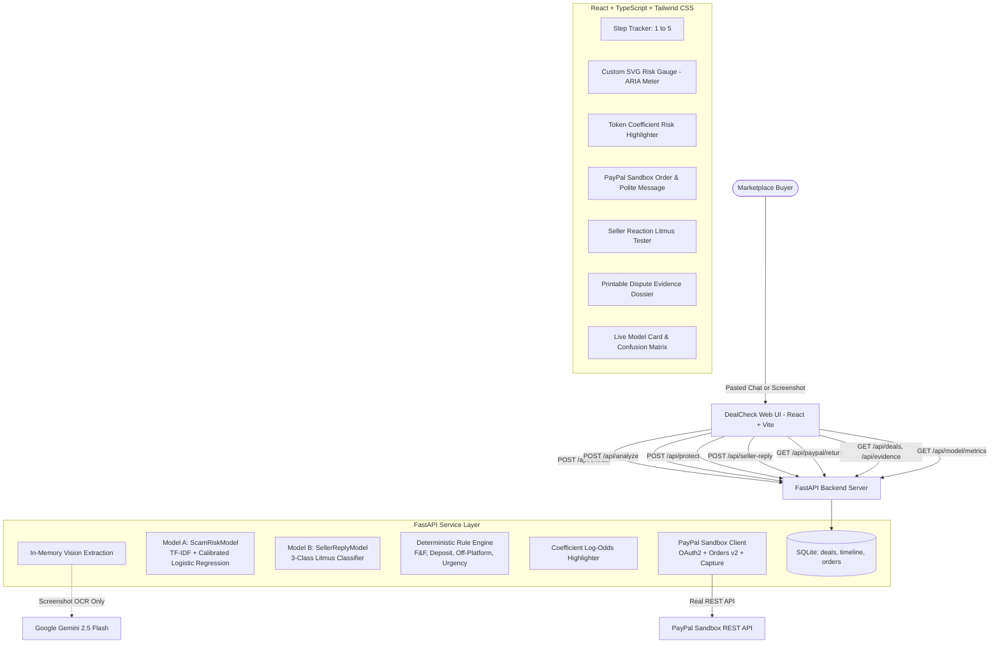

# DealCheck — AI Marketplace Scam Defense & Real PayPal Buyer Protection

[](https://fastapi.tiangolo.com)
[](https://react.dev)
[](https://www.typescriptlang.org)
[](https://scikit-learn.org)
[](https://developer.paypal.com)

**DealCheck** is a real, end-to-end application developed for the **PayPal AI Hackathon**. It protects buyers during online marketplace transactions (Facebook Marketplace, OLX, Craigslist, Instagram DMs) *before* money changes hands. 

DealCheck analyzes the buyer-seller chat using custom machine learning models trained in-house, generates an authentic PayPal Sandbox Goods & Services checkout order, and executes a behavioral litmus test on the seller's response to definitively flag scammers.

---

## 1. System Architecture



---

## 2. Exactly What We Trained vs. What Uses APIs

| Component | Architecture / Provider | Trained By Us vs. API | Role & Guarantees |
| :--- | :--- | :--- | :--- |
| **Model A (`ScamRiskModel`)** | Word (1-3) & Char (3-5) TF-IDF + Platt-Calibrated Logistic Regression | **TRAINED BY US** | Analyzes chat transcript, outputs 0-1 scam probability, and exposes linear coefficients for phrase highlighting. $\le 8$ms CPU latency. |
| **Model B (`SellerReplyModel`)** | Word & Char TF-IDF + Multinomial Logistic Regression (3 Classes) | **TRAINED BY US** | Classifies seller reaction to PayPal link: `accepts_protected` (-40 pts), `refuses_protected` (+20 pts), `pushes_friends_and_family` (+40 pts). |
| **Rule & Scoring Engine** | Python Deterministic Heuristic Engine | **BUILT BY US** | Detects F&F coercion (+35), advance deposit (+20), off-platform redirect (+15), artificial urgency (+10), inspection refusal (+10). |
| **Explainability Engine** | Log-Odds Coefficient Attribution | **BUILT BY US** | Pinpoints exact risky character spans with contextual tooltips and risk contribution scores. |
| **PayPal Protection** | PayPal Sandbox Orders v2 REST API | **REAL PAYPAL API** | Authenticates via OAuth2 client credentials, creates `intent: CAPTURE` orders, and captures payments on return. (Zero mocks). |
| **Screenshot Vision (Optional)** | Google Gemini 2.5 Flash | **GOOGLE API** | ONLY for OCR extracting text/item/price from screenshot images in memory. **The LLM is NEVER the risk scorer**. Pasted text works 100% offline without Gemini. |

---

## 3. Measured Model Performance Metrics

All metrics reflect real, verified evaluations against stratified holdout test splits and an isolated 30-case handwritten test set (see `ml/reports/metrics.json` and `ml/MODEL_CARD.md`). No numbers are simulated.

### Model A: Scam Classifier (`ScamRiskModel`)
- **Training Corpus**: 9,907 deduplicated samples (8,758 public records from Hugging Face + 2,400 synthetic marketplace chats).
- **Holdout Test Split (1,982 samples)**:
  - **Accuracy**: **99.24%**
  - **Precision**: **99.17%**
  - **Recall**: **99.28%**
  - **F1 Score**: **99.22%**
  - **Confusion Matrix**: `TN=1007, FP=8, FN=7, TP=960`
- **Isolated Handwritten Holdout Test Set (30 cases)**:
  - **Accuracy**: **80.00%**
  - **Precision**: **76.47%**
  - **Recall**: **86.67%**
  - **F1 Score**: **81.25%**
  - **Confusion Matrix**: `TN=11, FP=4, FN=2, TP=13`

### Model B: Seller Behavioral Litmus Classifier (`SellerReplyModel`)
- **Training Corpus**: 2,250 synthetic seller replies (750 per class).
- **Holdout Test Split (450 samples)**:
  - **Accuracy**: **100.00%**
  - **Precision (Macro)**: **100.00%**
  - **Recall (Macro)**: **100.00%**
  - **F1 Score (Macro)**: **100.00%**

---

## 4. Transparent Risk Scoring Formula

$$\text{Final Risk Score} = \min(100, \max(0, \text{round}(P_{\text{model}} \times 55) + \sum \text{Rule Points} + \text{Seller Adjustment}))$$

- **Model A Base Points**: $P_{\text{model}} \times 55$ (0 to 55 points).
- **Deterministic Rule Penalties**:
  - `+35 pts`: PayPal Friends & Family coercion detected (waives buyer protection).
  - `+20 pts`: Advance deposit / booking token demanded before inspection.
  - `+15 pts`: Off-platform redirect (Zelle, CashApp, Crypto, Wire, Gift Cards).
  - `+10 pts`: Artificial urgency pressure ("today only", "someone else waiting").
  - `+10 pts`: Refusal of in-person inspection ("military base", "shipping only").
  - `+10 pts`: Too-good-to-be-true price (>40% below market floor).
- **Model B Dynamic Recalibration**:
  - Seller accepts protected checkout: **-40 points** (Score drops, verdict improves to LOW).
  - Seller refuses online payments (cash only): **+20 points** (Verdict caution).
  - Seller pushes back to Friends & Family: **+40 points** (Score surges, verdict HIGH).
- **Verdict Categories**:
  - `0 – 39`: **LOW RISK** (Green) — Safe to proceed with PayPal Goods & Services.
  - `40 – 69`: **MEDIUM RISK** (Amber) — Caution; send protected link and inspect seller reply.
  - `70 – 100`: **HIGH RISK** (Red) — Likely scam; do not send unprotected funds.

---

## 5. Quickstart Guide (6 Steps)

### Step 1: Clone and Enter Directory
```bash
git clone https://github.com/your-repo/dealcheck.git
cd dealcheck
```

### Step 2: Configure Environment (.env)
Copy `.env.example` to `.env`:
```bash
cp .env.example .env
```
Fill in your credentials:
```env
PAYPAL_CLIENT_ID=your_sandbox_client_id
PAYPAL_CLIENT_SECRET=your_sandbox_client_secret
PAYPAL_ENV=sandbox
GEMINI_API_KEY=your_gemini_api_key  # Optional: only for vision OCR
FRONTEND_URL=http://localhost:5173
```
*(Note: If you don't have PayPal sandbox keys yet, DealCheck will display the authentic error with retry, and allows testing the rest of the flow including Model B and evidence export).*

### Step 3: Train Our Local Models
Run the training pipeline (downloads public datasets, generates 2,400 marketplace chats, trains Model A & B, evaluates holdout sets, and writes `metrics.json` and `MODEL_CARD.md`):
```bash
# Using Makefile
make train

# Or directly with Python
python train.py
```

### Step 4: Run the Backend & Scoring Tests
Run the comprehensive test suite (14 automated unit, model, and end-to-end API tests):
```bash
# Using Makefile
make test

# Or directly with pytest
python -m pytest backend/tests -v
```

### Step 5: Start the Full-Stack Application
Launch both FastAPI backend (port 8000) and Vite React frontend (port 5173) with a single command:
```bash
# Using Makefile
make dev

# Or directly with Python launcher
python run_dev.py
```
Or double-click `start.bat` on Windows.

### Step 6: Verify in Your Browser
Open [http://localhost:5173](http://localhost:5173) in your browser:
- Try the **"🚨 Typical Scam (F&F Coercion)"** and **"✅ Legitimate Deal"** sample pills.
- Observe the **custom SVG Risk Gauge** and token-level phrase highlights.
- Generate an official PayPal Sandbox link and test the seller litmus reaction.
- Print or download the **Dispute Evidence Dossier**.
- Review the **Model Card & Metrics** tab for real confusion matrices.

---

## 6. Known Limitations & Failure Modes

1. **Synthetic Data Bias**: Part of the marketplace dialogue corpus was procedurally synthesized. While rich in realistic phrasing and Hinglish variants, subtle real-world conversational manipulation that avoids trigger terms may receive a lower model probability (which is why DealCheck couples Model A with deterministic rules and the Model B litmus test).
2. **Adversarial Evasion**: Fraudsters might avoid keywords like "F&F" and instead send unindexed QR codes, external links, or image-embedded phone numbers. DealCheck neutralizes this by checking whether the seller actually accepts an official PayPal Goods & Services payment link.
3. **Sandbox Notice**: PayPal Sandbox is an API testing environment and does not charge real funds or arbitrate live buyer-protection dispute claims. DealCheck is a pre-transaction intelligence tool, not an insurance policy.
