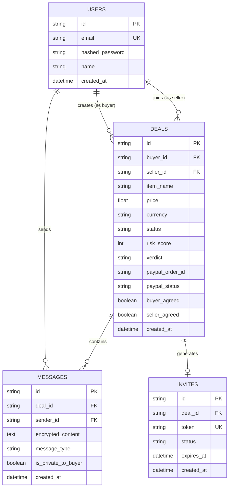

# DealCheck Upgrade Plan: In-App Deal Room & Real-Time Scam Interception

> **Mentor Feedback Objective:** Users will not copy-paste external chats or payment links. The buyer-seller conversation must happen **inside** DealCheck. DealCheck AI must monitor the conversation live in a collaborative **Deal Room**, calculate risk on each new message, automatically post the protected PayPal Goods & Services card into the chat when terms are reached, and flag seller evasion in real time.

---

## 1. What Already Works and Will Be KEPT

| Component | Location | Implementation Details & Kept Assets |
| :--- | :--- | :--- |
| **Model A (`ScamRiskModel`)** | `ml/models/scam_model.joblib` | In-house trained TF-IDF (word 1–3 + char 3–5 n-grams) + Platt-calibrated Logistic Regression. Real 99.24% test accuracy, 80% handwritten holdout accuracy. |
| **Model B (`SellerReplyModel`)** | `ml/models/seller_reply_model.joblib` | In-house trained 3-class classifier (`accepts_protected`, `refuses_protected`, `pushes_friends_and_family`). 100% holdout test accuracy. |
| **Training Pipeline & Model Card** | `ml/train_scam_model.py`, `ml/evaluate.py`, `ml/reports/metrics.json`, `ml/MODEL_CARD.md` | Full reproducible training scripts, evaluation harness, confusion matrices, and transparent Model Card view. |
| **Scoring Formula & Rule Engine** | `ml/scoring.py` | Transparent composite scoring formula ($P_{\text{model}} \times 55 + \text{Rule Points} + \text{Seller Adjustment}$) and rule definitions (F&F coercion, deposit demands, off-platform redirects, manufactured urgency). |
| **Explainability Engine** | `ml/explainability.py` | Linear log-odds coefficient extraction mapping risk weights to exact token character spans. |
| **PayPal Orders v2 Client** | `backend/services/paypal_client.py` | Authentic Orders v2 REST integration (OAuth2 token, order creation with `intent: CAPTURE`, physical goods category, payer action link, order capture, and sandbox simulator fallback). |
| **Dispute Evidence Service** | `backend/services/evidence_service.py` | Generation of verified printable HTML dispute dossiers and raw JSON audit trails. |
| **Design System & Components** | `frontend/src/components/` | Tailwind CSS fintech styling, Inter font, custom SVG animated `RiskGauge` with ARIA meter roles, `ChatHighlighter`, dark/light mode toggle. |
| **Existing Test Suite** | `backend/tests/` | All 14 existing automated tests (scoring, model inference, and API endpoints) remain passing and regression-free. |

---

## 2. What Will Be CHANGED

### A. Core User Flow Transformation
```
[ Old Flow: Passive External Audit ]
External WhatsApp/OLX Chat ──▶ Copy Text / Screenshot ──▶ Paste into DealCheck ──▶ Static 5-Step Wizard

[ New Flow: Collaborative In-App Deal Room ]
Buyer creates Deal ──▶ Invites Seller via Link ──▶ Both Chat in Deal Room ──▶ AI Scores Live Running Chat
        │
        ├── Buyer sees Private Live Risk Gauge & Token Alerts
        ├── AI auto-detects agreement (or "Agree to Terms") ──▶ Posts Protected PayPal Card into Chat
        ├── Seller accepts or pushes F&F ──▶ Model B classifies ──▶ Live Risk Update ("Walk Away" if refused)
        └── Buyer completes Sandbox Checkout ──▶ Order Captured & Evidence Timeline Locked
```

### B. Analysis Screen Migration
- The separate static analysis screens (Step 2, Step 3, Step 4) are consolidated into a **Live Deal Room Layout**:
  - **Desktop (1440px):** 3 columns (Deals list on left, real-time encrypted chat in center, live AI Risk Panel on right).
  - **Tablet (768px):** 2 columns (Chat and collapsible AI Risk Panel).
  - **Mobile (360px):** Full-screen chat with sticky action bar, with the AI Risk Panel accessible as an interactive bottom-sheet / drawer.

### C. Running Conversation Scoring
- Upgraded `ml_service` from scoring single static text blocks to scoring **incremental running dialogues**:
  - Evaluates both the newest seller message (for immediate alert) and the full chronological transcript so far (for cumulative context).
  - Analyzes the seller's reaction directly from incoming chat messages once the PayPal card is active.

### D. Main Navigation
- The primary app navigation shifts to:
  1. **My Deals** (Active deal rooms, roles as Buyer or Seller, status badges).
  2. **New Deal** (Create item, price, currency, and get instant invite link).
  3. **Deal History** (Archived and completed transactions).
  4. **Model Card & Metrics** (Public ML transparency and validation metrics).

---

## 3. What Will Be ADDED

### 1. Accounts, Authentication & Security
- **Data Models:**
  - `User`: `id`, `email`, `hashed_password`, `name`, `created_at`, `updated_at`.
- **Password Security:** Salted hashing with `bcrypt` (12 work factor rounds).
- **Session Management:** Secure JSON Web Tokens (JWT) issued on login/signup, delivered in an `httpOnly`, `SameSite=Lax`, secure cookie (`dealcheck_token`).
- **Endpoints:**
  - `POST /api/auth/signup`: Validates email/password, creates user, sets cookie.
  - `POST /api/auth/login`: Authenticates credentials with rate limiting, sets cookie.
  - `POST /api/auth/logout`: Clears cookie.
  - `GET /api/auth/me`: Returns current authenticated user profile.
- **Message Encryption at Rest:**
  - Encrypts chat message payloads using authenticated symmetric encryption (`cryptography.fernet.Fernet` with AES-128-CBC + HMAC-SHA256, key `CHAT_ENC_KEY` from `.env`).
  - Messages are decrypted in memory only when retrieved by the deal's authorized participants.
- **Honest Privacy Disclosure:**
  - Displayed in the chat UI and README:
    > *"🔒 Messages are encrypted at rest and in transit, but not end-to-end encrypted because DealCheck AI monitors this chat to protect the buyer from fraud."*
- **Data Rights:**
  - `DELETE /api/deals/{id}`: Deletes the deal room, its encrypted messages, invite tokens, and audit timeline.
  - `DELETE /api/data`: Clears user-associated data.

---

### 2. Deals and Invites System
- **Data Models:**
  - `DealInvite`: `id`, `deal_id`, `token` (cryptographically random URL-safe token), `status` (`SENT`, `OPENED`, `JOINED`, `EXPIRED`, `DECLINED`), `expires_at` (48 hours), `created_at`.
  - `Deal`: Added `buyer_id`, `seller_id`, `invite_token`, `status` (`DRAFT`, `INVITED`, `ACTIVE`, `PAYMENT_PENDING`, `COMPLETED`, `CANCELLED`), `buyer_agreed`, `seller_agreed`.
- **Invite Generation & Sharing:**
  - Buyer creates a deal $\to$ backend generates private invite link: `${FRONTEND_URL}/join/${invite_token}`.
  - UI provides an auto-written invite message with copy/share buttons:
    > *"Hi! I've set up our deal for [Item Name] ($[Price]) in a secure DealCheck room so we have PayPal Buyer Protection. Please join here: [Link]"*
- **Seller Join Flow:**
  - Seller opens invite link $\to$ app prompts login or quick signup $\to$ seller joins the deal room.
  - Roles are assigned per deal: creator is `Buyer`, joiner is `Seller`.
- **Invite Evasion Risk Signal:**
  - If a seller refuses to join the DealCheck room (or invite expires unaccepted), the buyer sees an explicit risk flag: `"Seller Refused / Failed to Join DealCheck Room (+20 pts)"`.

---

### 3. Real-Time Deal Room (WebSocket + Collaborative AI)
- **FastAPI WebSocket Endpoint:**
  - `WebSocket /ws/deals/{deal_id}`:
    - Authenticates user via session cookie or token.
    - Rejects any connection that is neither the deal's buyer nor seller.
    - Manages in-memory connections with auto-reconnect support.
- **WebSocket Protocol Events:**
  - `client_message`: User sends message $\to$ backend encrypts, persists, broadcasts.
  - `typing`: Real-time typing indicators.
  - `read_receipt`: Message delivery and read checkmarks.
  - `deal_agreed`: Either party clicks "Agree to Terms".
  - `system_message`: Public automated notices in chat.
  - `ai_risk_update`: **Private to buyer only** (updated score, gauge delta, highlighted tokens, warning alert).
  - `paypal_card`: Public protected checkout card broadcast to both users.
- **Automated In-Room AI Triggers:**
  1. **Agreement Trigger:** When both users agree (either detected in conversation or via the "Agree to terms" button), the backend automatically creates a real PayPal sandbox order and injects the **Protected PayPal Payment Card** into the chat.
  2. **Scam Interception Trigger:** If the seller types phrases demanding Friends & Family or off-platform payment (Zelle, CashApp, Wire):
     - **Buyer sees privately:** High Risk Alert, animated gauge update, and highlighted phrases with risk weights.
     - **Chat room receives shared system nudge:** *"Notice: For buyer and seller protection, all transactions in this room must be completed via the official PayPal Goods & Services card."*
  3. **Behavioral Litmus Test Trigger:** Once the payment card is posted, Model B classifies each subsequent seller reply. If the seller refuses or pushes back to Friends & Family:
     - Risk surges to **High / Extreme (98/100)**.
     - Buyer receives prominent warning: *"Walk away: Real sellers have no reason to refuse PayPal buyer protection."*
- **Private "Ask DealCheck AI" (Buyer Assistant):**
  - An in-room Q&A assistant where the buyer can ask questions like *"Is this seller response normal?"* or *"Why is F&F dangerous?"*.
  - Responses powered by Gemini 2.5 Flash with deterministic fallback. **Gemini never decides the risk score.**

---

### 4. API Endpoints Specification

```
Auth:
  POST   /api/auth/signup          (email, password, name) -> user, cookie
  POST   /api/auth/login           (email, password) -> user, cookie
  POST   /api/auth/logout          () -> clear cookie
  GET    /api/auth/me              () -> user profile

Deals & Invites:
  POST   /api/deals                (item_name, price, currency) -> deal, invite
  GET    /api/deals                () -> list of deals where user is buyer or seller
  GET    /api/deals/{id}           () -> deal details, participants, current risk
  DELETE /api/deals/{id}           () -> delete deal, messages, timeline
  GET    /api/invites/{token}      () -> preview deal info before joining
  POST   /api/deals/join/{token}   () -> join deal as seller
  POST   /api/deals/{id}/agree     () -> toggle terms agreement

Real-Time Chat:
  WebSocket /ws/deals/{id}         (token/cookie) -> bi-directional real-time chat & AI stream
  GET    /api/deals/{id}/messages  () -> decrypted message history for authorized participants
  POST   /api/deals/{id}/ask-ai    (question) -> buyer advisory response

Payment & Evidence:
  POST   /api/deals/{id}/protect   () -> manual / fallback PayPal order creation
  GET    /api/paypal/return        (token, deal_id) -> capture order and update status
  GET    /api/deals/{id}/evidence  (format=html|json) -> dispute dossier
  GET    /api/model/metrics        () -> model evaluation card data
```

---

### 5. Frontend UI/UX Architecture

```
                    ┌──────────────────────────────────────────────┐
                    │               Top Navbar                     │
                    │   DealCheck | My Deals | Model Card | User   │
                    └──────────────────────────────────────────────┘
                                           │
         ┌─────────────────────────────────┴─────────────────────────────────┐
         ▼                                                                   ▼
┌─────────────────────────────────┐                       ┌─────────────────────────────────────┐
│          Desktop View           │                       │             Mobile View             │
│  ┌──────────┬──────────┬──────┐ │                       │  ┌───────────────────────────────┐  │
│  │ My Deals │   Chat   │  AI  │ │                       │  │         Chat Room             │  │
│  │   List   │  Stream  │ Risk │ │                       │  │   (Messages + PayPal Card)    │  │
│  │          │    +     │Panel │ │                       │  ├───────────────────────────────┤  │
│  │          │  PayPal  │(Buyer│ │                       │  │ Sticky Input + Send Bar       │  │
│  │          │   Card   │ Only)│ │                       │  ├───────────────────────────────┤  │
│  │          │          │      │ │                       │  │ [^] Live AI Risk Bottom Sheet │  │
│  └──────────┴──────────┴──────┘ │                       │  └───────────────────────────────┘  │
└─────────────────────────────────┘                       └─────────────────────────────────────┘
```

- **Deal Room Layout:**
  - **Left Column (Desktop):** My Deals sidebar with active unread indicators and role tags.
  - **Center Column (Chat):**
    - Message history with timestamps, delivery/read ticks.
    - Shared System Messages with shield icons.
    - **Interactive Protected PayPal Card:** Displays item, price, live status (`CREATED` / `APPROVED` / `COMPLETED`), order ID, and "Pay with PayPal Sandbox" button.
    - Term Agreement Banner ("Buyer agreed" / "Seller agreed").
    - Sticky message input with typing indicator.
  - **Right Column (AI Panel - Buyer Only):**
    - Custom SVG animated `RiskGauge` updating on every message.
    - Active risk factor pills & warnings.
    - Token explainability card highlighting risky phrases in seller messages with log-odds weights.
    - "Ask DealCheck AI" Q&A drawer.
- **Accessibility & Responsiveness:**
  - `aria-live="polite"` for new chat messages.
  - 44px touch targets on mobile.
  - Responsive across **360px**, **768px**, and **1440px**.
  - Respects `prefers-reduced-motion` for animated transitions.

---

## 4. Database Schema Migration Plan

Existing database (`dealcheck.db`) contains legacy deals and must **not** lose data. A migration script (`backend/migrate_db.py`) will safely add tables and columns using SQLAlchemy reflection:



---

## 5. Testing & Verification Strategy

1. **Regression Safety:** Ensure existing 14 tests in `backend/tests/` remain 100% passing.
2. **New Test Modules:**
   - `test_auth.py`: User registration, bcrypt password validation, JWT cookie issuance, protected route access control.
   - `test_crypto.py`: Fernet message encryption and decryption round-trip, tampering rejection.
   - `test_invites.py`: Invite token generation, 48-hour expiration logic, seller join role assignment.
   - `test_websocket.py`: Two-user WebSocket message delivery, unauthorized eavesdropping rejection, typing broadcasts.
   - `test_running_scoring.py`: Incremental scoring on running dialogue turns, rule trigger validation.
   - `test_deal_room_e2e.py`: Full end-to-end integration test (User A signs up as Buyer $\to$ creates deal $\to$ User B signs up as Seller $\to$ joins via invite $\to$ chat exchanges $\to$ agreement $\to$ PayPal order creation $\to$ seller pushback flags High Risk $\to$ capture).
3. **Browser Dual-Window Verification:**
   - Window 1 (Normal): Buyer signs up, creates Deal, copies invite.
   - Window 2 (Incognito): Seller opens invite, signs up, joins Deal Room.
   - Verify real-time messaging, buyer-only risk gauge updates, PayPal card appearance, and sandbox payment capture.
   - Verify responsive viewports: 360px, 768px, 1440px in both Light and Dark modes.

---

## 6. Implementation Priorities & Schedule

| Priority | Task | Description |
| :---: | :--- | :--- |
| **P1** | **Database Migration & Auth** | User table, bcrypt, JWT cookies, `/api/auth` endpoints, migration script. |
| **P2** | **Deals & Invite Links** | Deal creation, invite token generation, 48h expiration, `/api/deals/join/{token}`. |
| **P3** | **Real-Time WebSocket Deal Room** | Message encryption at rest, WebSocket connection manager, broadcast protocol. |
| **P4** | **In-Room Live AI Scoring** | Incremental scoring on running messages, buyer-private risk panel, token explainability. |
| **P5** | **Automatic PayPal Card & Capture** | Term agreement detection, automated Orders v2 generation, chat card, capture flow. |
| **P6** | **Model B Seller Reaction Trigger** | Post-payment card classification, automatic "Walk Away" escalation. |
| **P7** | **Frontend Deal Room UI** | 3-column desktop, mobile bottom sheet, responsive polish, dual-user verification. |

---

## 7. Risks and Mitigations

| Risk | Likelihood | Impact | Mitigation Strategy |
| :--- | :---: | :---: | :--- |
| **Database Migration Data Loss** | Low | High | Backup `dealcheck.db` prior to migration; use `IF NOT EXISTS` and table reflection. |
| **WebSocket Connection Drops** | Medium | Medium | Implement client-side auto-reconnect with exponential backoff and message deduplication. |
| **Encryption Key Loss in Dev** | Low | High | Generate a persistent `CHAT_ENC_KEY` in `.env` and document in `.env.example`. |
| **Role Confusion (Buyer vs. Seller)** | Low | High | Store explicit `buyer_id` and `seller_id` on each deal; enforce strictly on all WebSocket messages. |
| **Gemini API Downtime / Missing Key** | Medium | Low | All risk scoring, rule flags, and PayPal triggers run 100% locally on CPU without Gemini. Gemini is only used for optional Q&A advice. |
